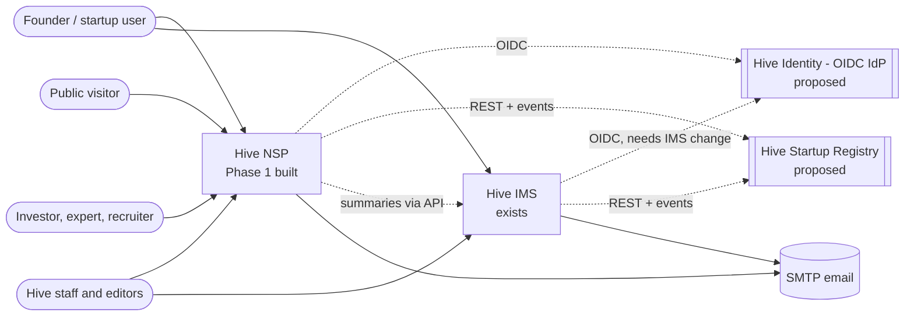
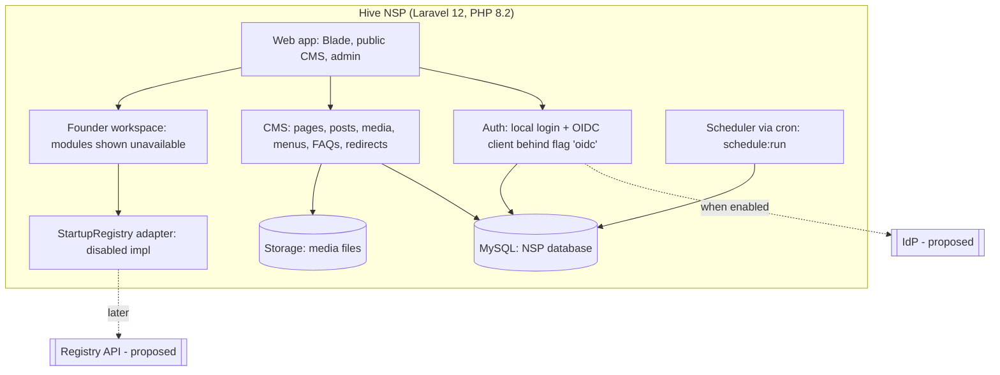
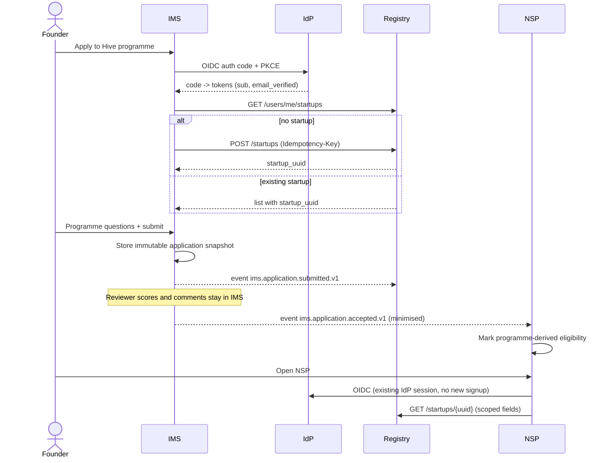
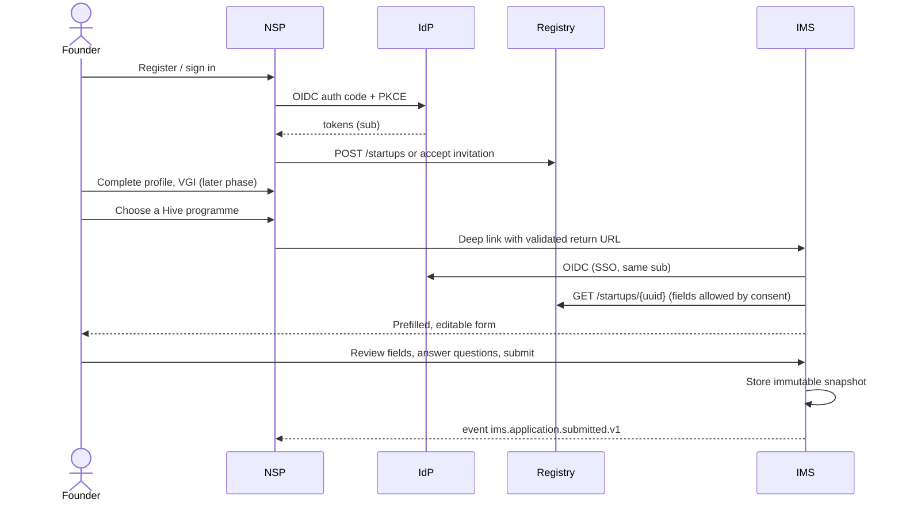

# Architecture (Phase 0)

**Date:** 4 November 2026
**Status:** Proposed architecture for owner approval. Only the NSP Phase 1 foundation and CMS are implemented (see `phase-status.md`). The IdP, the registry and every IMS endpoint in this document are **proposed and do not exist yet**. Nothing here is deployed.

Sources: the owner's specification (§3, §5, §7) and `discovery.md`.

## 1. Logical services

| Service | Responsibility | State today |
|---|---|---|
| Hive Identity (IdP) | OIDC login, user lifecycle, MFA, password reset, verified email, sessions, logout | Does not exist. Choice pending (D1). |
| Hive Startup Registry | Canonical `startup_uuid`, shared core profile, memberships, founders, field provenance, consent, aliases, duplicate review | Does not exist. Hosting pending (D2). NSP has a `StartupRegistry` adapter interface with a "disabled" implementation. |
| Hive IMS | Applications, programme questions, eligibility, review and scoring, cohorts, milestones, programme documents | Exists. Custom PHP on shared cPanel. Local login only, no API, no startups table. |
| Hive NSP | Public CMS (Phase 1). Later: growth/VGI, investors, experts, talent, opportunities, marketplace, recommendations, analytics | Phase 1 implemented locally. Later modules are behind feature flags and show as unavailable. |
| Integration layer | REST APIs, signed events, outbox, idempotent inbox, retries, dead letter, reconciliation | Proposed. See `ims-integration.md`. |

## 2. Deployment options

### 2.1 Preferred: separate apps, shared IdP, registry API
- IMS, NSP and the registry are separate deployable apps with separate databases.
- All three trust one OIDC IdP.
- The registry owns shared startup data. IMS and NSP read and write it only through the registry API (`api/openapi.yaml`) and events.
- No shared mutable tables. No database-to-database writes.

### 2.2 Fallback: isolated registry module in an owner app
Use this if hosting cannot support a third app at first.
- The registry runs as a module inside one agreed app (most likely NSP, because it is Laravel and can run a scheduler).
- It has its own tables with a `registry_` prefix, its own service classes and its own routes under `/api/v1`.
- No other module in the host app reads or writes registry tables directly. It calls the same API client as IMS does, or the same service interface.
- It exposes the same API contract as 2.1, so it can later move out without client changes.

| Trade-off | Preferred | Fallback |
|---|---|---|
| Hosting cost and setup | Higher (third app, possibly a VPS) | Lower |
| Blast radius of an outage | Registry outage is separate | Host app outage also stops the registry |
| Risk of hidden coupling | Low | Medium; needs code review rules and tests |
| Extraction later | Not needed | Move tables and module; clients unchanged |

Migration path from fallback to preferred: copy `registry_*` tables to a new database, deploy the module as its own app, point `REGISTRY_BASE_URL` at it, keep the old URL as a redirect for one release.

## 3. C4 context diagram



Dotted lines are proposed. Solid lines exist or are implemented in Phase 1.

## 4. C4 container diagram (NSP)



## 5. Journey A: IMS-first (proposed)



## 6. Journey B: NSP-first (proposed)



## 7. Event delivery with cron on shared hosting (proposed)

IMS has no queue workers. NSP hosting may also be cron-only (D10). Delivery therefore uses an outbox polled by cron every minute.

```mermaid
sequenceDiagram
    participant App as Producer app
    participant DB as Producer DB
    participant Cron as cron (every minute)
    participant C as Consumer endpoint
    participant CDB as Consumer DB
    App->>DB: BEGIN; business write; INSERT outbox row; COMMIT
    Cron->>DB: SELECT due rows (status=pending, next_attempt_at<=now) LIMIT n FOR UPDATE SKIP LOCKED
    Cron->>C: POST event, HMAC signature + timestamp
    C->>C: Verify signature, timestamp within 5 min
    C->>CDB: INSERT inbox(event_id) unique
    alt new event_id
        C->>CDB: Apply change in same transaction
        C-->>Cron: 200
    else duplicate
        C-->>Cron: 200 (already processed)
    end
    alt 2xx
        Cron->>DB: mark delivered
    else error or timeout
        Cron->>DB: attempts+1, next_attempt_at = backoff
        Note over Cron,DB: After max attempts: status=dead, alert admin
    end
```

Notes:
- MySQL 8 supports `SKIP LOCKED`. If the IMS MariaDB version does not, use a lock row or a `claimed_by` + `claimed_at` column.
- Each cron run has a time budget (for example 50 seconds) so runs do not overlap.
- On NSP, Laravel's scheduler runs from one cron entry (`php artisan schedule:run`). A `queue:work --stop-when-empty` call can be scheduled if Laravel jobs are used.

## 8. Deviation: Laravel 12 on PHP 8.2

| Item | Spec | Built |
|---|---|---|
| Framework | Laravel 13 (subject to runtime check) | Laravel 12 |
| PHP | 8.3+ | 8.2 |

Reason: the local PHP is 8.2 and the target hosting is believed to be 8.2. Laravel 13 needs PHP 8.3.

Upgrade path (decision D11):
1. Confirm hosting can run PHP 8.3 or later.
2. Keep dependencies on versions that support both Laravel 12 and 13 (spatie/laravel-permission already does).
3. Avoid APIs deprecated in Laravel 12.
4. Upgrade on a branch, run the test suite, test on staging, then release.

## 9. Constraints carried from discovery
- IMS is not Laravel and has no API. Every IMS endpoint here is new IMS work and needs separate authorization.
- IMS has no stable startup ID. Linking uses `startup_aliases` and human review.
- IMS hosting cannot run Keycloak or another Java/Go IdP. The IdP must be managed or hosted elsewhere (D1).
