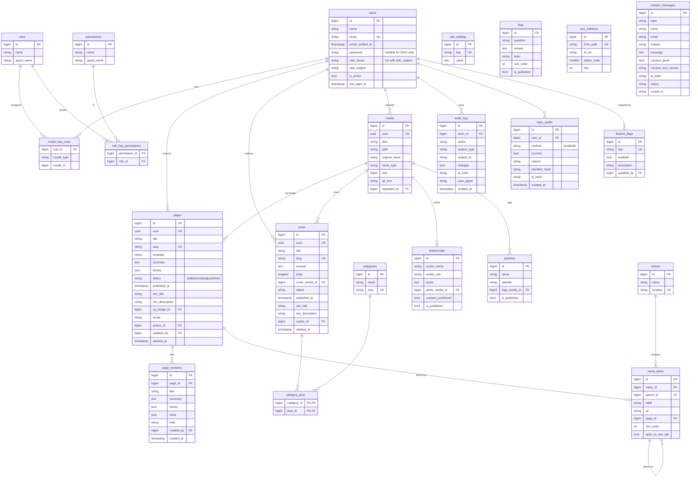

# Entity relationship diagrams

**Date:** 4 November 2026

| Part | Status |
|---|---|
| (a) Registry schema | **Proposed, not built.** Based on spec §4. Final columns depend on D2, D3 and D4. |
| (b) NSP Phase 1 tables | **Implemented** as migrations in `database/migrations/`. Not deployed. |
| (c) Later NSP table groups | **Proposed, not built.** Names only. |

## (a) Registry schema (proposed, not built)

All keys are UUIDs. `user_subject` is the IdP `sub` claim, scoped by issuer. H-sensitivity fields (see `data-ownership.md`) are encrypted at rest.

```mermaid
erDiagram
    startups ||--|| startup_profiles : has
    startups ||--o{ startup_memberships : has
    startups ||--o{ startup_founders : has
    startups ||--o{ startup_field_provenance : tracks
    startups ||--o{ startup_aliases : "known as"
    startups ||--o{ data_sharing_consents : governs
    startups ||--o{ startup_merge_requests : "source or target"
    startups ||--o{ registry_outbox_events : emits

    startups {
        uuid uuid PK
        string legal_name
        string display_name
        string registration_number "nullable"
        string country
        smallint year_founded
        text description
        string website
        string status
        int version "ETag source"
        timestamp archived_at "nullable"
        timestamps created_updated
    }
    startup_profiles {
        uuid startup_uuid PK,FK
        int sector_id
        int sub_sector_id
        string headquarters_location
        int team_size
        string revenue_band "encrypted"
        text traction_summary "encrypted"
        decimal funding_raised_amount "encrypted"
        char funding_currency
        string contact_email "encrypted"
        string contact_phone "encrypted"
        tinyint profile_completion
        string visibility
        timestamp updated_at
    }
    startup_memberships {
        uuid uuid PK
        uuid startup_uuid FK
        string user_subject
        string role "owner|founder|admin|team_member|viewer"
        string invite_status
        string invited_by
        timestamp accepted_at
        timestamp revoked_at
    }
    startup_founders {
        uuid uuid PK
        uuid startup_uuid FK
        string user_subject "nullable"
        string name
        string title
        decimal ownership_pct "optional, encrypted"
        string visibility
        string consent_status
    }
    startup_field_provenance {
        bigint id PK
        uuid startup_uuid FK
        string field_name
        string source_system
        string updated_by
        int version
        timestamp verified_at
        uuid consent_reference
    }
    startup_aliases {
        bigint id PK
        string source_system "UK with external_id"
        string external_id
        uuid startup_uuid FK
    }
    startup_merge_requests {
        uuid uuid PK
        uuid source_uuid FK
        uuid target_uuid FK
        json evidence
        string decision
        string approver
        json migration_journal "for unmerge"
        timestamp decided_at
    }
    data_sharing_consents {
        uuid uuid PK
        uuid startup_uuid FK
        string actor_subject
        string purpose
        string recipient_system
        json fields_scope
        string policy_version
        timestamp granted_at
        timestamp revoked_at
    }
    registry_outbox_events {
        uuid event_id PK
        string type
        uuid subject_uuid
        json payload
        string status
        int attempts
        timestamp next_attempt_at
    }
    registry_inbox_receipts {
        uuid event_id PK
        string source
        timestamp received_at
    }
    sync_failures {
        bigint id PK
        uuid event_id
        string target
        text last_error
        timestamp failed_at
    }
```

Constraints (proposed):
- `startup_memberships`: one active membership per `(startup_uuid, user_subject)`. MySQL has no partial unique index, so use a generated column `active_key` = `user_subject` when `revoked_at IS NULL`, else NULL, and a unique index on `(startup_uuid, active_key)`.
- `startup_aliases`: unique `(source_system, external_id)`.
- Registry also has its own `audit_logs`.

## (b) NSP Phase 1 tables (implemented, not deployed)

Spatie tables (`roles`, `permissions`, `model_has_roles`, `model_has_permissions`, `role_has_permissions`) are shown in short form. Laravel framework tables (`sessions`, `cache`, `jobs`, `password_reset_tokens`) are omitted.

Notes:
- Most tables also have `created_at` and `updated_at`; they are left out of the diagram for space.
- IP addresses and login identifiers are stored as hashes, not plain values.
- Scheduling: a page or post with `status = scheduled` becomes visible when `published_at <= now`.
- Phase 1 NSP tables have no `startup_uuid` yet, because no startup data exists in Phase 1.

## (c) Later NSP table groups (proposed, not built)

Names follow spec §8. Every startup-related table will carry `startup_uuid` with a tenant-scope index.

| Group | Tables |
|---|---|
| Identity cache | `startup_membership_cache` |
| Growth | `vgi_frameworks`, `vgi_dimensions`, `vgi_questions`, `vgi_options`, `vgi_assessments`, `vgi_responses`, `vgi_scores`, `growth_stages`, `growth_plans`, `growth_goals`, `growth_actions`, `growth_updates`, `startup_metrics_history` |
| Capital | `investor_profiles`, `investor_preferences`, `funding_requests`, `investment_opportunities`, `startup_investor_matches`, `investor_introductions`, `deal_pipeline`, `data_room_files`, `data_room_grants` |
| Experts | `expert_profiles`, `expert_skills`, `consultation_requests`, `consultation_bookings`, `mentorship_matches`, `mentorship_sessions`, `session_actions`, `expert_reviews` |
| Talent | `talent_profiles`, `talent_skills`, `vacancies`, `job_applications`, `interviews`, `hiring_pipeline_events` |
| Ecosystem | `opportunities`, `opportunity_categories`, `opportunity_applications`, `bookmarks`, `events`, `event_registrations`, `marketplace_listings`, `marketplace_inquiries`, `partnership_requests` |
| CMS additions | `tags`, `translations`, `content_blocks` (reusable blocks) |
| Operations | `notifications`, `notification_preferences`, `message_templates`, `support_tickets`, `integration_outbox`, `integration_inbox`, `integration_failures`, `webhook_deliveries`, `recommendations`, `recommendation_feedback`, `export_jobs` |
